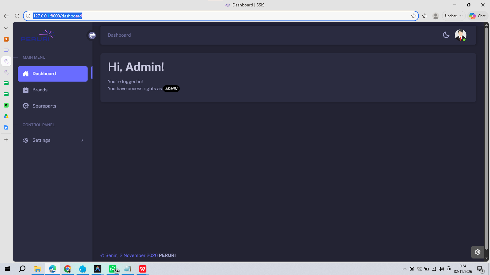

# Panduan Agent AI — SSIS
> **Wajib dibaca di awal setiap sesi kerja.** Ini adalah ringkasan konteks proyek dan sumber awal untuk orientasi agent, agar tidak perlu membaca seluruh repository sebelum memahami sistem. Konteks di bawah ini disusun dari dokumentasi dan kode yang ada saat ini; bila ada perbedaan, verifikasi bagian kode yang relevan dan perbarui dokumen ini.

## Aturan wajib pemeliharaan dokumen
Setelah melakukan perubahan pada proyek, agent **WAJIB memperbarui `AGENTS.md` dalam pekerjaan yang sama** jika perubahan tersebut mengubah atau menambahkan salah satu hal berikut: fitur/perilaku, arsitektur atau alur data, model/schema, route/API, dependensi/konfigurasi, cara instalasi atau menjalankan aplikasi, proses background, keamanan/otorisasi, keterbatasan, atau status pekerjaan.

- Perbarui bagian konteks terkait supaya sesuai dengan implementasi aktual.
- Tambahkan catatan di [Riwayat perubahan](#riwayat-perubahan) untuk perubahan yang bermakna: tanggal, ringkasan, dan file/komponen utama.
- Jangan mencatat perubahan yang belum benar-benar dibuat atau belum diverifikasi. Tandai hal yang belum pasti dengan jelas.
- Perubahan dokumentasi saja atau refactor internal yang tidak memengaruhi konteks sistem tidak harus masuk ke riwayat, tetapi koreksi informasi yang sudah tidak benar.
- Jika pekerjaan terhenti sebelum perubahan dokumentasi selesai, catat sebagai tindak lanjut yang belum selesai; jangan membuat klaim bahwa dokumentasi sudah mutakhir.
- Sebelum menyelesaikan tugas, cek apakah dokumen ini perlu diperbarui. Jika tidak ada perubahan konteks yang relevan, tidak perlu menambah entri riwayat.

## Ringkasan proyek
**SSIS (Sparepart Stock Information System)** adalah aplikasi web Laravel untuk pengelolaan master data suku cadang, merek, kategori, pengguna dan hak akses, ditambah pencarian teks dan pencarian gambar berdasarkan kemiripan visual (CBIR). Backend web dan layanan pencarian gambar Python adalah proses terpisah.

### Stack yang diketahui
- **Backend:** Laravel 10, PHP `^8.1`, Eloquent ORM.
- **Database:** relasional; konfigurasi aktual lewat `.env` (README mencontohkan MySQL/MariaDB).
- **UI:** Blade, Vite, Tailwind CSS, Alpine.js; Bootstrap Icons juga tersedia.
- **Paket penting:** `spatie/laravel-permission` (role/permission), `yajra/laravel-datatables-oracle` (DataTables), `maatwebsite/excel` (import/template), `rap2hpoutre/laravel-log-viewer`, Laravel Breeze.
- **Pencarian gambar:** Flask + TensorFlow/Keras ResNet50 + ChromaDB + NumPy/Pillow, berjalan dari virtual environment `venv-tf/` di Windows.
- **Background jobs:** Laravel queue; dokumentasi proyek mengasumsikan database queue dan worker yang berjalan terus-menerus.
- Versi dan paket yang benar adalah yang tercantum di `composer.json`, `package.json`, serta lockfile; jangan menebak versi library Python yang belum dipatok di dependency manifest.

## Fitur dan domain
- **Akun dan profil:** autentikasi, verifikasi email, perubahan profil/password; rute auth ada di `routes/auth.php`.
- **Otorisasi:** role dan permission melalui Spatie; pengelolaan pengguna, role, permission, serta akses berbasis permission. Seeder terkait berada di `database/seeders/`.
- **Master data:** CRUD merek, kategori, sparepart; daftar data menggunakan DataTables server-side. Modul merek dan sparepart memiliki import Excel dan unduh template.
- **Sparepart:** kode/nama barang, deskripsi, merek, kategori, lokasi penyimpanan, jumlah stok dan satuan. Satu sparepart dapat memiliki beberapa gambar.
- **Pencarian:** pencarian teks serta pencarian gambar dari halaman search.
- **Pemantauan:** log viewer dilindungi permission `log-viewers.read`.

## Arsitektur dan alur penting
### Struktur kode utama
- `app/Models/` — model `User`, `Brand`, `Category`, `Sparepart`, `SparepartImage` dan relasi.
- `app/Http/Controllers/` — controller auth/profil, user/role/permission, merek/kategori/sparepart, dan pencarian.
- `app/Http/Requests/` — validasi input.
- `app/Policies/` — otorisasi resource.
- `app/Jobs/IndexSparepartVector.php` — job queue untuk indexing gambar.
- `app/Services/ResnetServiceClient.php` — klien HTTP Laravel ke layanan Python.
- `app/Console/Commands/` — perintah indexing/reindex dan utilitas uji/debug.
- `routes/web.php`, `routes/auth.php`, `routes/console.php` — route web/auth/console.
- `database/migrations/`, `database/seeders/` — schema dan data awal.
- `resources/views/` — template Blade.
- `scripts/resnet_service.py` — layanan Flask ResNet50/ChromaDB; launcher `.bat` juga ada di `scripts/`.
- `storage/app/chroma_db/` — penyimpanan persisten vektor; data/runtime lokal, jangan dianggap sebagai kode sumber.

### Search gambar (CBIR)

1. Service Python `scripts/resnet_service.py` memuat ResNet50 (`include_top=False`, `pooling='avg'`) saat startup. Gambar diubah menjadi vektor fitur 2048 dimensi dan dinormalisasi L2.
2. ChromaDB `PersistentClient` menyimpan koleksi `sparepart_images` di `storage/app/chroma_db/`, dengan metrik cosine dan ID berupa ID sparepart.
3. Laravel menghubungi service memakai `ResnetServiceClient` dan URL konfigurasi `services.resnet.url` (README menyebut env `PY_SERVICE_URL`, default `http://127.0.0.1:5005`; periksa `config/services.php` bila mengubah konfigurasi).
4. Endpoint service: `GET /health`, `POST /index`, `POST /search`, `POST /delete` pada port `5005` dan host lokal `127.0.0.1` secara default.
5. Upload/perubahan gambar dapat menjadwalkan `IndexSparepartVector` ke queue. Job mengirim gambar ke `/index`, lalu mengatur status `is_indexed`; job mencoba ulang hingga 3 kali dengan backoff 15 detik. Pastikan queue worker aktif.
6. Pencarian meminta kandidat terdekat (default 5), mengembalikan ID dan skor kemiripan; controller Laravel menghubungkan ID tersebut ke data sparepart.
7. Jika service tidak tersedia, indexing queue dapat gagal/diulang dan pencarian gambar tidak berfungsi. Gunakan `/health` untuk mengecek status dan jumlah vector.

## Data dan konfigurasi yang perlu diketahui
- `Sparepart` memiliki relasi `brand`, `category`, dan `images`; `is_indexed` adalah boolean status indexing; `vector_path` menyimpan path terkait indexing.
- Gambar sparepart disimpan di disk publik Laravel (contoh `storage/app/public/spareparts/`). Model gambar membentuk URL melalui route `storage.media`; ada pula route fallback `/storage/{path}`.
- Konfigurasi lokal rahasia ada di `.env`; jangan pernah menyalin credential, APP_KEY, token, password, atau data sensitif ke dokumen/commit.
- Database harus dimigrasikan dan storage publik perlu disiapkan sesuai lingkungan. Jangan menjalankan perintah reset/destruktif seperti `migrate:fresh` tanpa permintaan eksplisit.
- `.env.example` dan README adalah panduan setup; cocokkan dengan konfigurasi aplikasi aktual sebelum mengubah instruksi.

## Route dan akses level tinggi
- `/` halaman awal; `/dashboard` memerlukan `auth` dan `verified`; `/profile` memerlukan `auth`.
- `/search` dan `/search/results`; pencarian gambar `POST /search/image`.
- Pengaturan akun berada di prefix `/setting/manage_account/` (users, roles, permissions), di balik `auth`.
- Master data berada di prefix `/master_data/` dan di balik `auth`: merek, sparepart, endpoint data DataTables, import/template.
- Log viewer memakai middleware `can:log-viewers.read`.
- Periksa `routes/web.php` untuk nama route, HTTP verb, serta middleware terbaru; ringkasan ini bukan daftar route lengkap.

## Menjalankan dan memverifikasi (Windows / PowerShell)

Ikuti `README.md` untuk setup lengkap dan nilai env. Secara umum komponen development yang diperlukan adalah:

1. MySQL/MariaDB dan database sesuai `.env`.
2. Dependency: `composer install`, `npm install`; setup key, migrasi/seeder, dan `php artisan storage:link` bila dibutuhkan.
3. Layanan pencarian: `venv-tf\Scripts\python.exe scripts\resnet_service.py` (atau `scripts\start_resnet_service.bat`); tunggu model siap.
4. Worker: `php artisan queue:work --tries=3 --timeout=300` (atau launcher `scripts\start_queue_worker.bat`).
5. Laravel: `php artisan serve` untuk development lokal; dokumentasi performa menyarankan web server multi-worker untuk penggunaan lebih serius.
6. Frontend: `npm run dev` untuk hot reload atau `npm run build`.

### Menjalankan seluruh stack dalam satu terminal (Windows)
Dari root proyek, jalankan `start-ssis.bat` atau `powershell -ExecutionPolicy Bypass -File .\scripts\start-ssis.ps1`. Python ResNet service, queue worker, Vite, dan Laravel dijalankan sebagai proses anak tanpa membuka jendela console baru; Laravel tersedia di `http://127.0.0.1:8000`. Launcher menunggu health check Python hingga 180 detik sebelum melanjutkan. Semua proses berjalan selama terminal ini terbuka; tekan `Ctrl+C` untuk menghentikan launcher dan seluruh service yang dijalankannya. Perintah ini juga cocok dijalankan di terminal terintegrasi IDE.

Prasyarat: MySQL/MariaDB harus aktif dan `.env`/database sudah dikonfigurasi, serta `venv-tf`, dependency Composer, dan npm sudah terpasang. Launcher tidak menyalakan database dan tidak melakukan instalasi atau migrasi otomatis. Jika dependency belum siap atau konfigurasi DB tidak valid, jalankan setup README terlebih dahulu.

Perintah reindex yang didokumentasikan: `php artisan sparepart-images:index`, `php artisan spareparts:reindex`, dan `php artisan spareparts:reindex --sync`. Periksa `php artisan list`/implementasi command sebelum mengandalkan opsi tertentu, karena interface command bisa berubah.

### Verifikasi perubahan
- PHP: jalankan test relevan (`php artisan test`) dan/atau formatter/linter yang sesuai perubahan.
- Frontend: `npm run build` bila ada perubahan asset/view terkait.
- Python: verifikasi sintaks/perilaku service yang berubah sesuai environment yang tersedia.
- Integrasi CBIR memerlukan database, queue worker, dan service Python aktif; jangan klaim integrasi end-to-end berhasil jika prasyarat tersebut tidak diuji.
- Catat pengujian yang dijalankan dan hasilnya di ringkasan respons; bila relevan, tambahkan status pentingnya ke riwayat perubahan di bawah.

## Dokumen rujukan
- `README.md` — instalasi, konfigurasi, menjalankan sistem, reindex, troubleshooting.
- `README_PERFORMANCE_FIX.md` — latar belakang pemindahan indexing ke queue dan layanan ResNet persisten.
- `PRD_CONTEXT.md` — ringkasan kebutuhan dan overview historis; bila berbeda dengan implementasi, kode dan konfigurasi terkini yang menjadi sumber kebenaran.
- File sumber terkait — rujuk hanya bagian yang relevan bila perlu detail implementasi atau ketika informasi ringkas ini tidak cukup.

## Status konteks dan hal yang perlu dikonfirmasi
- Dokumen ini merangkum desain dan implementasi yang tampak di repository saat dibuat; **bukan bukti bahwa semua layanan/deployment sedang berjalan**.
- Ada perbedaan detail antar dokumen lama (misalnya README menyebut Flask service, sedangkan `PRD_CONTEXT.md` menggambarkan pemanggilan skrip Python langsung). Kode yang diperiksa saat ini menunjukkan Flask service persisten dipanggil oleh Laravel; gunakan implementasi aktual sebagai acuan.
- README menyatakan URL layanan dapat diatur melalui `PY_SERVICE_URL`; untuk memastikan pemetaan env persis, periksa `config/services.php` dan `.env.example` saat mengubah alur konfigurasi.
- Jangan menganggap dokumentasi ini catatan lengkap setiap commit. Riwayat di bawah dimulai saat file ini dibuat; tambahkan entri pada perubahan berikutnya yang memengaruhi konteks.

## Riwayat perubahan
- **2026-11-01** — Membuat `AGENTS.md` sebagai pintu masuk konteks agent; merangkum stack, fitur, alur CBIR, queue, konfigurasi penting, cara menjalankan, dan aturan wajib pemutakhiran dokumentasi. Disusun dari dokumentasi dan file kode yang ditinjau; belum merupakan verifikasi runtime seluruh sistem.
- **2026-11-01** — Menambahkan launcher Windows `start-ssis.bat` dan `scripts/start-ssis.ps1` untuk menjalankan Python ResNet, queue worker, Vite, dan Laravel dalam satu terminal; dokumentasi diperbarui. MySQL harus dijalankan terpisah.
- **2026-11-01** — Memperbaiki peluncuran proses anak di `scripts/start-ssis.ps1`: PHP dan Node dijalankan lewat executable `.exe` yang ditemukan di PATH, menghindari pemanggilan `npm.ps1` yang bukan aplikasi Win32. Sintaks script dan keberadaan executable/dependency lokal sudah diperiksa; peluncuran end-to-end belum diuji ulang.
- **2026-11-01** — Menyelaraskan elemen konten halaman `/dashboard` (font Inter/Poppins, palet warna biru dan dark mode, ikon Bootstrap, kartu akses/role, dan quick access) dengan tema `/` dan `/search`, sambil mempertahankan layout aplikasi dan sidebar yang sudah ada; implementasi di `resources/views/dashboard.blade.php`. Kompilasi Blade berhasil; pemeriksaan visual browser tidak tersedia karena dependensi browser automation (`patchright`) tidak ditemukan.
